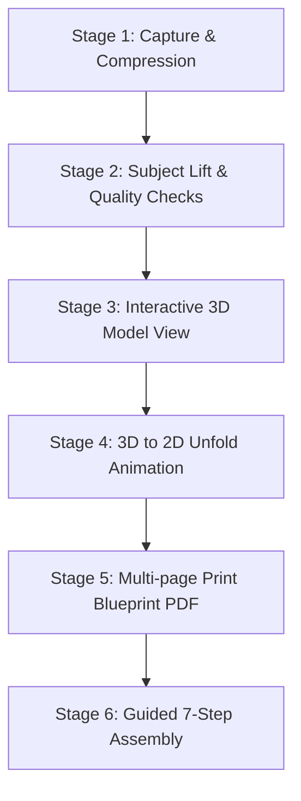

# Foldly Mobile App & 3D Workflow Upgrade Plan

## 🎯 Overview
Enhance the mobile experience in [`mobile/app/workflow.tsx`](mobile/app/workflow.tsx) and component stages located under [`mobile/components/workflow/`](mobile/components/workflow/) to provide smoother interactive visual feedback, robust error handling, and polished 3D / unfold representations.

---

## 🏗️ Workflow & Architecture Plan

---

## 📋 Proposed Implementation Steps

### 1. Stage 3 (3D Model Preview) Refinement
- **File:** [`mobile/components/workflow/Stage3Preview3D.tsx`](mobile/components/workflow/Stage3Preview3D.tsx:50)
- **Enhancements:**
  - Enhance pseudo-3D extrusion rendering with custom edge rendering based on selected `edgeColorHex`.
  - Add continuous auto-spin toggle in addition to gesture panning.
  - Display dynamic cardstock GSM calculation based on physical height parameter (`heightCm`).

### 2. Stage 4 (Unfold Scrubber) Animation & Visualization
- **File:** [`mobile/components/workflow/Stage4Unfold.tsx`](mobile/components/workflow/Stage4Unfold.tsx:38)
- **Enhancements:**
  - Animate individual side gusset tabs and fold lines splitting away from the front and back face.
  - Implement spring cubic easing curve for smooth scrubbing feedback.

### 3. Stage 2 (Subject Lift) Edge Quality & Manual Polish
- **File:** [`mobile/components/workflow/Stage2Lift.tsx`](mobile/components/workflow/Stage2Lift.tsx)
- **Enhancements:**
  - Add retry state cards if background job or polish API fails.
  - Improve visual quality metrics display (Solidity, Sharpness, Edge Integrity).

### 4. Stage 5 (Print & PDF Export) Calibration & Preview
- **File:** [`mobile/components/workflow/Stage5Print.tsx`](mobile/components/workflow/Stage5Print.tsx) & [`mobile/utils/pdfTemplate.ts`](mobile/utils/pdfTemplate.ts:1)
- **Enhancements:**
  - Ensure 50 mm calibration ruler displays accurately in HTML/PDF export.
  - Add seamless paper toggle (A4 / US Letter) with persisted user preferences.

### 5. Workflow State Coordinator & Resilience
- **File:** [`mobile/app/workflow.tsx`](mobile/app/workflow.tsx:48)
- **Enhancements:**
  - Add Android back handler safeguards during long-running background tasks.
  - Ensure local storage sync on creation completion (`saveCreation` / `updateCreation`).
